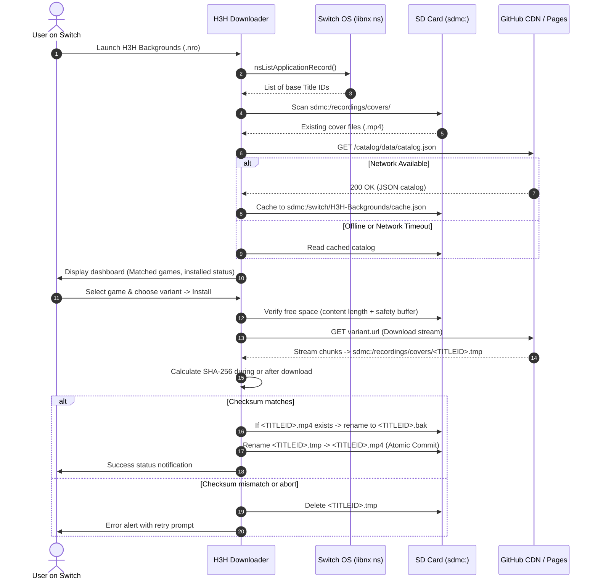

# H3H Backgrounds — System Architecture

## 1. System Overview

H3H Backgrounds is a unified software ecosystem designed specifically for the Nintendo Switch custom firmware **4IFIR («Чефир»)** and its video background subsystem (`sdmc:/recordings/covers/`).

The ecosystem consists of three tightly coupled components sharing a single source of truth (the Versioned Catalog Schema):

```
+-------------------------------------------------------------------------------+
|                             GitHub Infrastructure                             |
|  +---------------------------+        +------------------------------------+  |
|  | GitHub Pages              |        | GitHub Releases                    |  |
|  | (Static Web + Catalog v1) |        | (MP4 Video Asset CDN)              |  |
|  +---------------------------+        +------------------------------------+  |
+-------------------------------------------------------------------------------+
           ^                                                ^
           | HTTPS JSON                                     | HTTPS MP4
           v                                                v
+--------------------------+    +-----------------------+   +-------------------+
|  H3H Backgrounds Library |    |   H3H Downloader      |   |  H3H Studio       |
|  (Web / React + Vite)    |    |   (Switch Homebrew)   |   |  (Windows Desktop)|
|                          |    |                       |   |                   |
| - Browse catalog         |    | - Scan Title IDs      |   | - Mode A: Artwork |
| - Video previews         |    | - Match installed     |   | - Mode B: Game    |
| - Filter by tags/styles  |    | - SHA-256 verify      |   | - Mode C: Custom  |
| - Manual download        |    | - Atomic SD install   |   | - Encode & verify |
| - Community submission   |    | - Backup / Rollback   |   | - Catalog export  |
+--------------------------+    +-----------------------+   +-------------------+
```

---

## 2. Core Components

### 2.1 H3H Backgrounds Downloader (Nintendo Switch Homebrew)
- **Target Platform:** Nintendo Switch (OLED, V1, V2, Lite) running 4IFIR CFW (Atmosphere base).
- **Format:** Native `.nro` (Nintendo Relocatable Object).
- **Core Languages:** C++17, standard devkitPro / devkitA64 toolchain, libnx.
- **Rendering & Input:** SDL2 with hardware acceleration, TTF font rendering, and SDL GameController API supporting Joy-Con (Handheld and Split) and Pro Controller.
- **Networking:** HTTPS client (libcurl on Switch with TLS certificate validation via system/embedded CA bundle, or native sockets with mbedTLS).
- **Target Filesystem:** `sdmc:/recordings/covers/<TITLEID>.mp4`.
- **Primary Responsibilities:**
  1. Detect installed base games via libnx `ns` service (ignoring orphan updates and DLCs).
  2. Query `sdmc:/recordings/covers/` with case-insensitive matching to find existing backgrounds.
  3. Fetch the remote catalog (`catalog.v1.json`) with local caching and offline fallback.
  4. Allow user to browse available variants, preview metadata, and queue downloads.
  5. Download to a temporary file (`.tmp`), verify file size and SHA-256 digest, perform atomic swap with automatic backup (`.bak`), and provide rollback capabilities.

### 2.2 H3H Backgrounds Library (Web Application)
- **Target Platform:** Web (Desktop, Tablet, Mobile browsers).
- **Framework:** React 19, TypeScript, Vite.
- **Hosting:** GitHub Pages (static distribution, zero backend server requirement for read operations).
- **Catalog Source:** Single canonical `catalog.json` published directly in the repository.
- **Features:**
  1. Fast instant search by Game Name, Title ID, Style, or Author.
  2. Video preview player with sound toggle and loop controls.
  3. Filter by tags (`Cinematic`, `Gameplay`, `Animated Art`, `Minimal`, `Dark`, `Retro`).
  4. Direct manual download of verified MP4 assets with checksum instructions.
  5. Submission guidelines and GitHub Issue template / PR flow for community moderation.

### 2.3 H3H Background Studio (Windows Desktop Tool)
- **Target Platform:** Windows 10/11 x64.
- **Framework:** Python 3.12+, PySide6 (Qt for Python), FFmpeg & FFprobe integration.
- **Modes:**
  - **Mode A (Animated Artwork):** Import static art, configure Ken Burns pan/zoom, subtle camera drift, lighting/particle overlays, seamless looping, and export.
  - **Mode B (Gameplay / Trailer):** Import raw capture or game trailer, trim in/out points, crossfade loop boundary, audio leveling/mute, and 4IFIR compliance export.
  - **Mode C (Custom Video / Direct Transcode):** Import arbitrary MP4/MKV, inspect with FFprobe against 4IFIR profile, fix incompatible parameters (Level, Profile, Chroma, moov atom), and export with target Title ID.
- **Catalog Integration:** Generates verified JSON metadata entry (SHA-256, duration, bitrate, resolution) ready to be added to `catalog.json`.

---

## 3. Data Flow and Network Protocol



---

## 4. Key Architectural Boundaries and Invariants

1. **Title ID is Ground Truth:**
   - Switch Title IDs are strictly 16 hexadecimal uppercase characters (e.g. `01005CA01580E000`).
   - The filesystem search is strictly case-insensitive (`01005ca01580e000.mp4` matches `01005CA01580E000.mp4`).
   - Target filename generated on write is ALWAYS strictly uppercase: `<TITLEID>.mp4`.
2. **Read-Only System Boundary:**
   - The Downloader NEVER opens or touches NAND, game saves (`sdmc:/Nintendo/save/`), game updates, tickets, or firmware binaries.
   - All write operations are strictly confined to:
     - `sdmc:/recordings/covers/` (the 4IFIR video background directory)
     - `sdmc:/switch/H3H-Backgrounds/` (local application configuration, cache, and logs)
3. **No Unvalidated Remote Paths:**
   - The Downloader ignores filenames suggested by HTTP headers (e.g. `Content-Disposition`) or catalog URL paths. The destination path is computed deterministically from the validated 16-hex Title ID.
4. **Graceful Degradation:**
   - If the network is absent, the application boots into offline mode, showing all locally installed games and current cover status using the local cache.
   - If memory is constrained (Applet mode), heavy image caching is bypassed or throttled to keep heap usage well below safe applet limits (< 32 MB).
